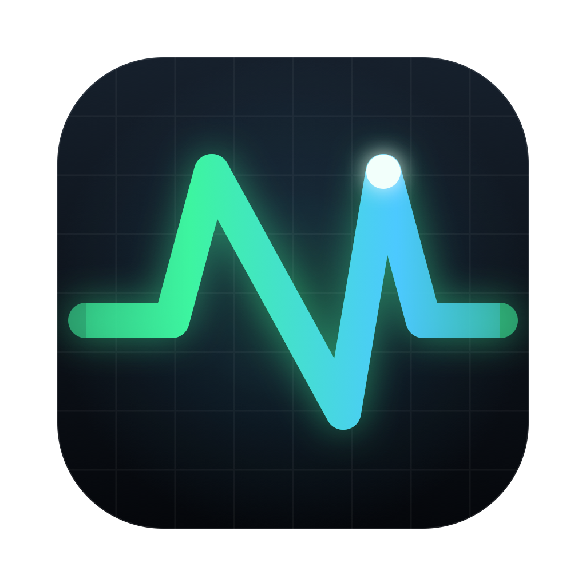
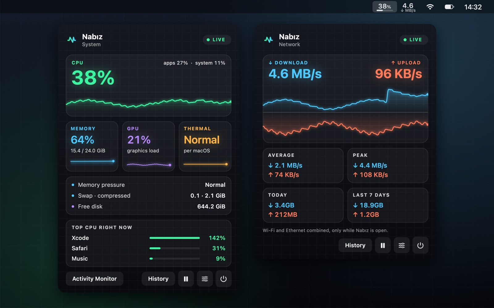
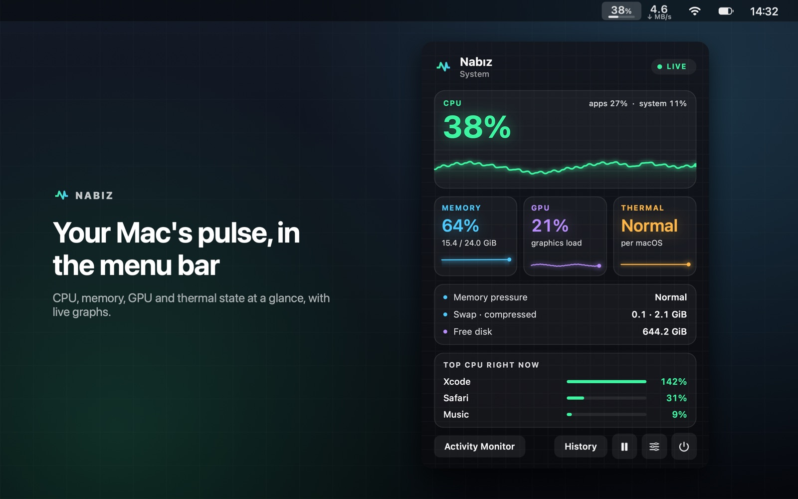
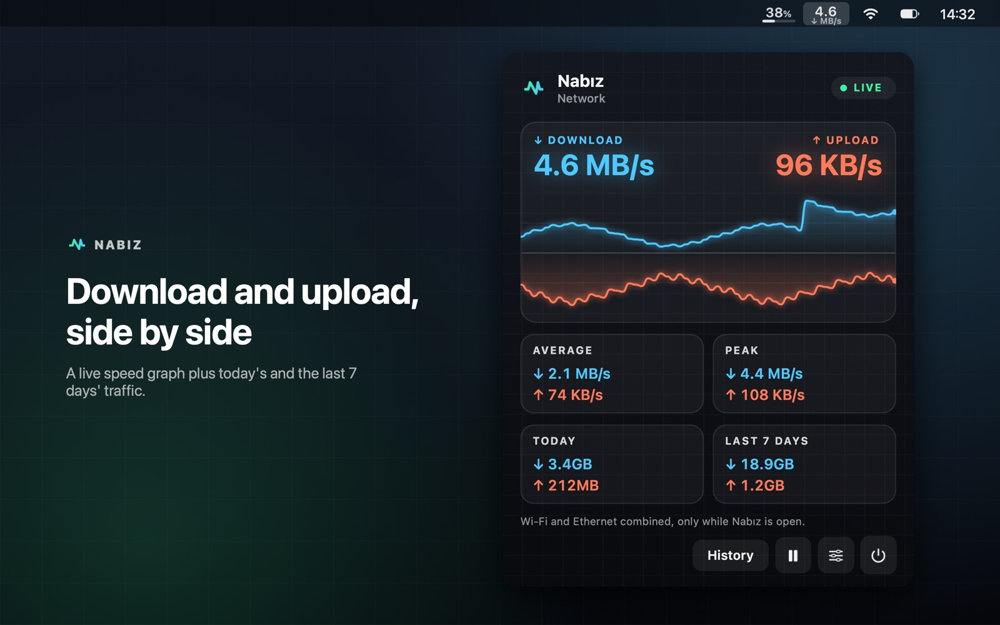
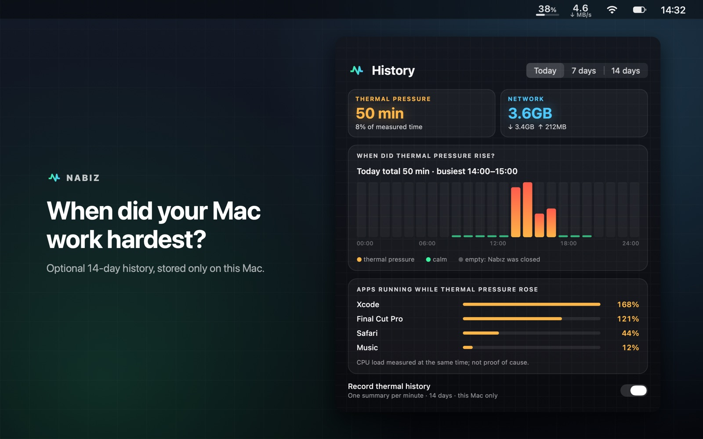
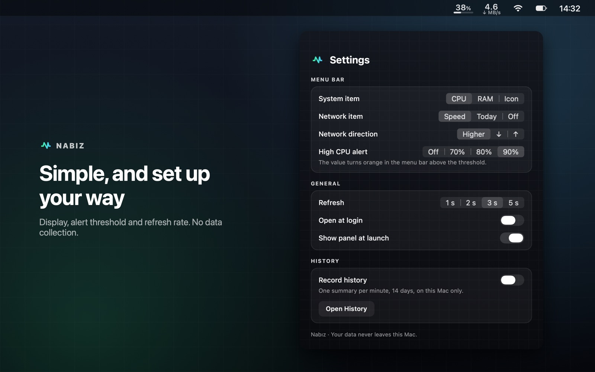

<p align="center"></p>

<h1 align="center">Nabız</h1>
<p align="center"><b>A free, open-source CPU, memory, GPU and network monitor for the macOS menu bar.</b><br>
Live graphs, two compact menu bar items, no data collection.</p>

<p align="center">
<a href="https://omeryasironal.github.io/nabiz/">Website</a> ·
<a href="README.tr.md">Türkçe</a> ·
<a href="docs/privacy.html">Privacy</a> ·
<a href="LICENSE">MIT License</a>
</p>

<p align="center"></p>

## Features

- **System panel:** CPU usage with a live graph split into apps and system, memory, GPU, macOS thermal state, memory pressure, swap, free disk and the apps using the most CPU right now.
- **Network panel:** download and upload on one mirrored graph, average and peak speed, traffic today and over the last 7 days.
- **Optional history:** per-minute summaries kept for 14 days on your Mac, showing when it worked hardest and which apps were running.
- **Compact menu bar items:** large rounded numbers with a thin load bar and fixed widths, so your menu bar never jumps. Show CPU, RAM or just a pulse icon.
- **Private:** fully sandboxed, no accounts, ads, analytics or network requests.
- **Native and light:** Swift and AppKit, no dependencies. Turkish and English interface.

| System | Network | History | Settings |
| --- | --- | --- | --- |
|  |  |  |  |

## Install

Nabız is coming to the Mac App Store. Until then, build it from source.

**Requirements:** macOS 13 Ventura or later (Apple silicon or Intel), Xcode command line tools and a code signing identity. Sandboxed apps need a stable signing identity, so ad-hoc signing is refused.

```bash
git clone https://github.com/OmerYasirOnal/nabiz.git
cd nabiz/app
NABIZ_SIGN_IDENTITY="Apple Development: Your Name (TEAMID)" ./build.zsh
open build/Nabiz.app
```

`security find-identity -v -p codesigning` lists the identities on your Mac. If you have exactly one *Developer ID Application* identity, `./build.zsh` picks it automatically.

### Two flavors

| | Built from source | Mac App Store |
| --- | --- | --- |
| CPU temperature and fan speed | Yes (temporary IOKit exception for the SMC) | No, shows macOS thermal state |
| History metric | High fan time | Thermal pressure time |
| Architectures | Apple silicon | Universal |

The App Store build is made with `NABIZ_APPSTORE=1 NABIZ_PROFILE=… ./build.zsh`.

## How it works

Nabız reads system statistics through public APIs only: `host_statistics`, `sysctl` process info, IOKit registry properties (GPU), `ProcessInfo.thermalState` and interface counters. Network totals and the optional history are stored in a small SQLite file inside the app's sandbox container. Nothing leaves your Mac.

| File | Role |
| --- | --- |
| `app/main.swift` | Sampling loop, status items, popovers |
| `app/MenuMeter.swift` | Menu bar item drawing |
| `app/Panels.swift` | System and network panels, shared UI |
| `app/History.swift` | History window |
| `app/Settings.swift` | Preferences, language helper `L(tr, en)` |
| `app/Ledger.swift` | Local SQLite storage |
| `app/Metrics.c` | Low-level host, process and SMC reads |
| `app/check.zsh` | Signature, sandbox and live metric checks |

Run the self tests with `build/Nabiz.app/Contents/MacOS/Nabiz --self-test` or the full check with `./check.zsh`.

## Contributing

Issues and pull requests are welcome. Please keep the app dependency-free, sandboxed and private: no network access, no telemetry.

## License

MIT © 2026 Ömer Yasir Önal
