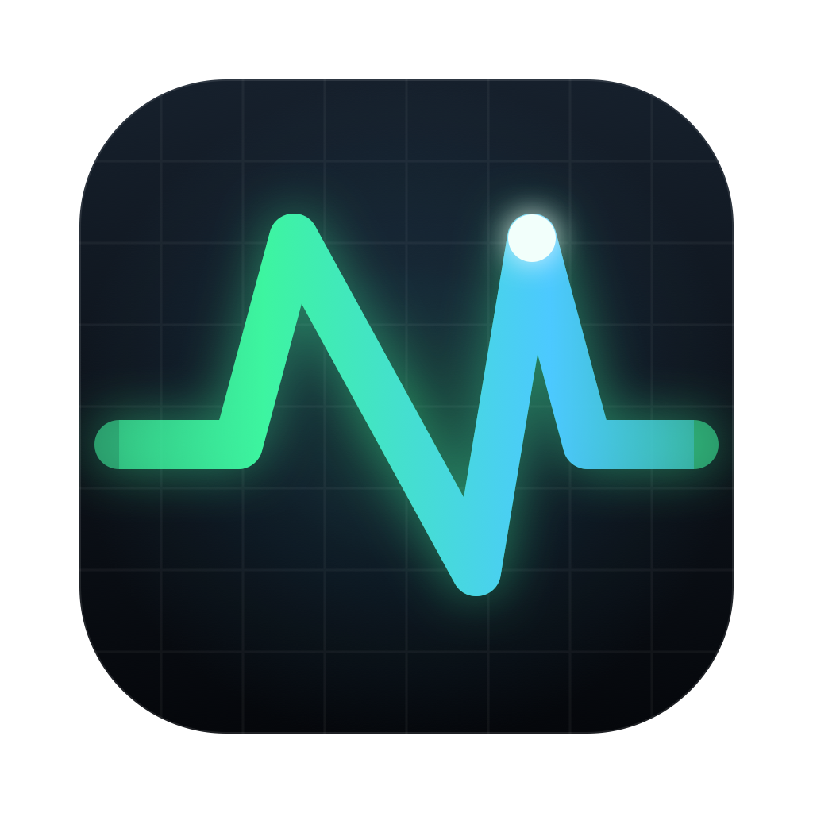
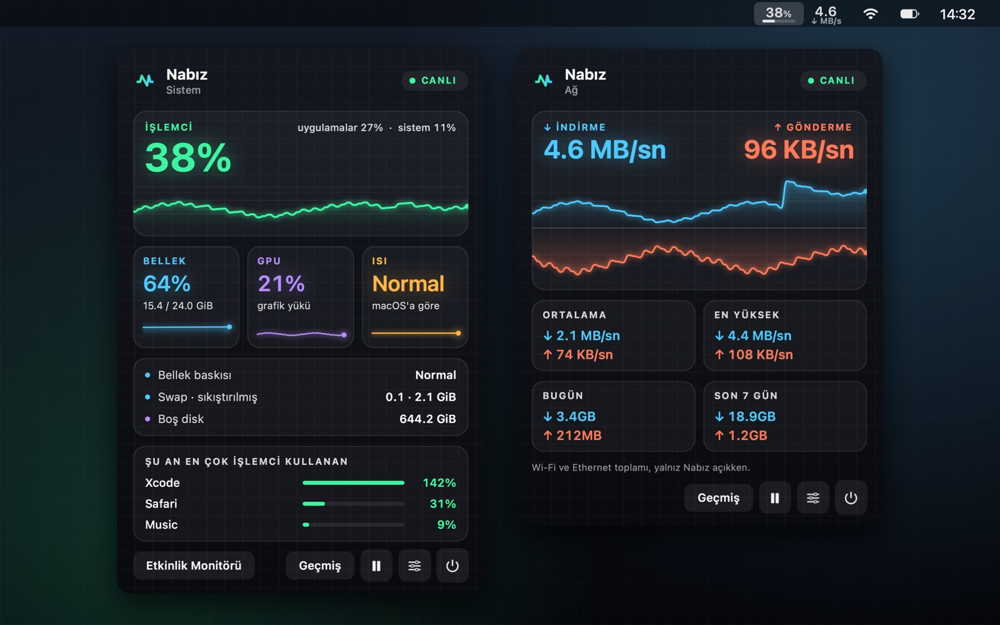
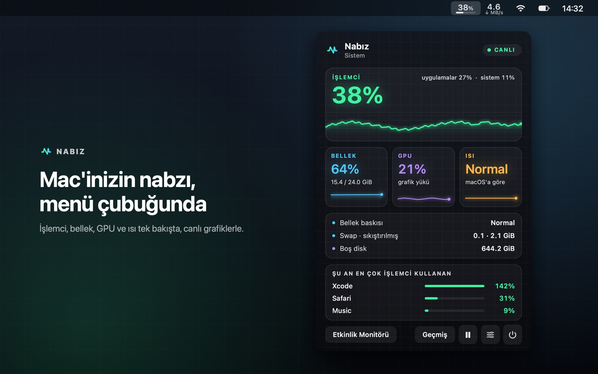
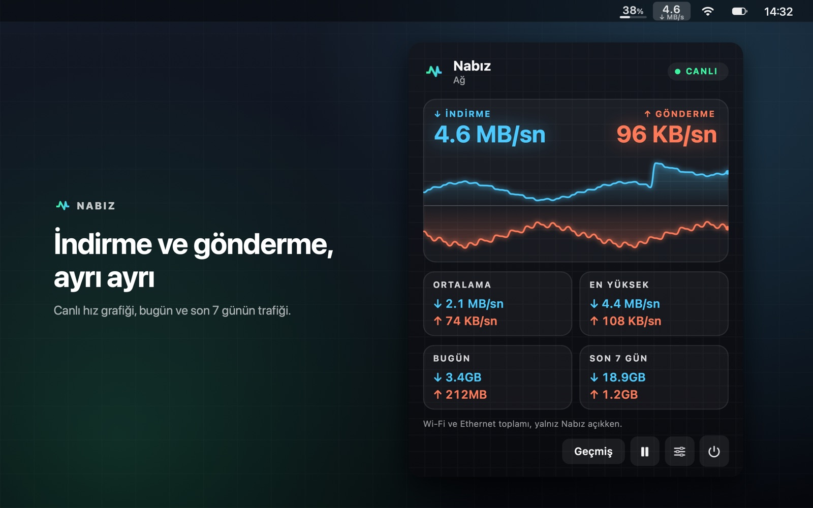
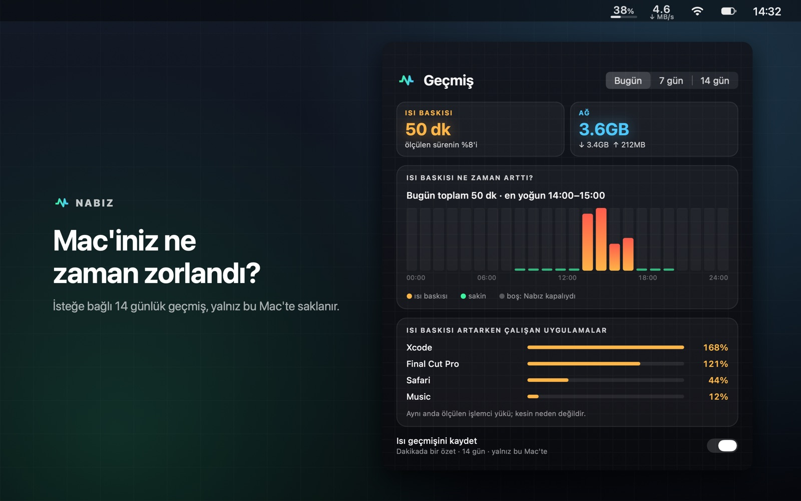
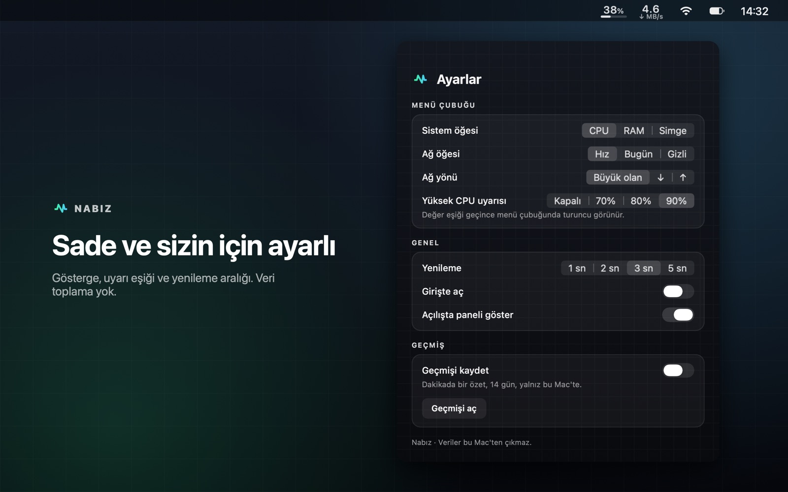

<p align="center"></p>

<h1 align="center">Nabız</h1>
<p align="center"><b>macOS menü çubuğu için ücretsiz, açık kaynak işlemci, bellek, GPU ve ağ monitörü.</b><br>
Canlı grafikler, menü çubuğunda iki küçük öğe, veri toplamaz.</p>

<p align="center">
<a href="https://omeryasironal.github.io/nabiz/tr/">Web sitesi</a> ·
<a href="README.md">English</a> ·
<a href="docs/privacy.html#tr">Gizlilik</a> ·
<a href="LICENSE">MIT Lisansı</a>
</p>

<p align="center"></p>

## Özellikler

- **Sistem paneli:** uygulama ve sistem payı ayrı canlı işlemci grafiği, bellek, GPU, macOS ısı durumu, bellek baskısı, swap, boş disk ve şu an en çok işlemci kullanan uygulamalar.
- **Ağ paneli:** indirme ve gönderme aynı grafikte, ortalama ve en yüksek hız, bugün ve son 7 günün trafiği.
- **İsteğe bağlı geçmiş:** dakikalık özetler 14 gün Mac'inizde saklanır; ne zaman zorlandığını ve o sırada hangi uygulamaların çalıştığını gösterir.
- **Az yer kaplar:** büyük, yuvarlak rakamlar, ince yük çubuğu ve sabit genişlik. CPU, RAM ya da yalnız nabız simgesi.
- **Gizlilik:** tamamen sandbox içinde; hesap, reklam, analiz veya ağ isteği yok.
- **Yerel ve hafif:** Swift ve AppKit, bağımlılık yok. Türkçe ve İngilizce arayüz.

| Sistem | Ağ | Geçmiş | Ayarlar |
| --- | --- | --- | --- |
|  |  |  |  |

## Kurulum

Nabız yakında Mac App Store'da. O zamana kadar kaynaktan derleyebilirsiniz.

**Gereksinimler:** macOS 13 Ventura ve sonrası (Apple silicon veya Intel), Xcode komut satırı araçları ve bir kod imzalama kimliği. Sandbox uygulamaları sabit bir imza ister; ad-hoc imza kabul edilmez.

```bash
git clone https://github.com/OmerYasirOnal/nabiz.git
cd nabiz/app
NABIZ_SIGN_IDENTITY="Apple Development: Adınız (TEAMID)" ./build.zsh
open build/Nabiz.app
```

Mac'inizdeki kimlikleri `security find-identity -v -p codesigning` listeler. Tek bir *Developer ID Application* kimliğiniz varsa `./build.zsh` onu kendisi seçer.

Kaynaktan derlenen sürüm işlemci sıcaklığını ve fan hızını da okur; Mac App Store sürümü sandbox nedeniyle macOS ısı durumunu gösterir.

## Katkı

Hata bildirimleri ve pull request'ler açıktır. Uygulama bağımlılıksız, sandbox içinde ve gizliliğe saygılı kalmalı: ağ erişimi ve telemetri yok.

## Lisans

MIT © 2026 Ömer Yasir Önal
